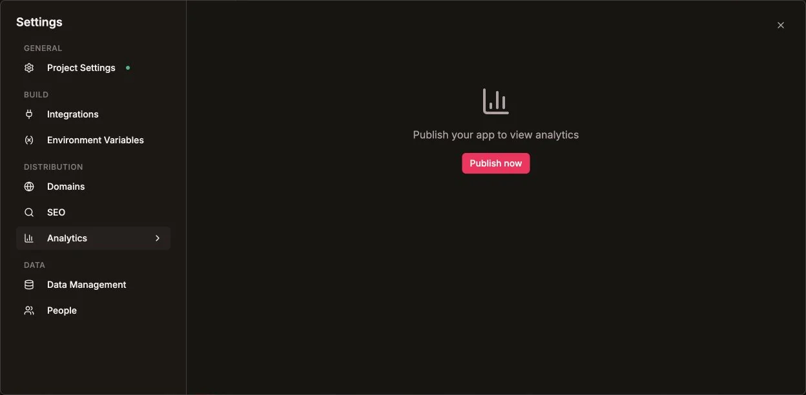
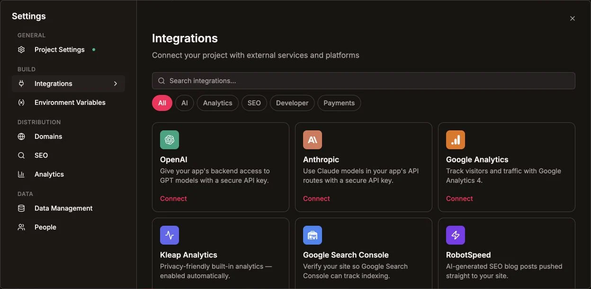

Understand how users interact with your app using built-in analytics.

## Kleap Analytics

Published apps include analytics tracking:

- **Page views** - Track which pages are visited
- **Unique visitors** - Count individual users
- **Referrers** - See where traffic comes from
- **Geography** - Visitor locations
- **Devices** - Desktop, mobile, tablet breakdown

## Enabling Analytics

Analytics are automatically enabled when you publish your app.

### Viewing Analytics

1. Go to **Settings** > **Analytics**
2. View metrics directly in your Kleap dashboard

<Frame caption="Choose Analytics under Distribution in Project settings">
  
</Frame>

### Dashboard Metrics

| Metric | Description |
|--------|-------------|
| **Visitors** | Unique users in time period |
| **Page Views** | Total page loads |
| **Bounce Rate** | Single-page visit percentage |
| **Avg. Duration** | Time spent on site |
| **Top Pages** | Most visited pages |
| **Top Referrers** | Traffic sources |

## Web Vitals

Track Core Web Vitals for performance:

- **LCP** (Largest Contentful Paint) - Loading performance
- **FID** (First Input Delay) - Interactivity
- **CLS** (Cumulative Layout Shift) - Visual stability

<Info>
  Good Web Vitals improve SEO rankings and user experience.
</Info>

## Real-Time Data

See visitors on your site right now:

- Current active users
- Pages being viewed
- Geographic distribution

## Time Periods

View analytics for different periods:

- Last 24 hours
- Last 7 days
- Last 30 days
- Custom date range

## Traffic Sources

Understand where your visitors come from:

| Source | Examples |
|--------|----------|
| **Direct** | Typed URL, bookmarks |
| **Search** | Google, Bing, DuckDuckGo |
| **Social** | Twitter, LinkedIn, Facebook |
| **Referral** | Other websites linking to you |

## Geographic Data

See visitor locations:

- Country breakdown
- City-level data (Pro plan)
- Map visualization

## Device Analytics

Understand your audience's devices:

- **Desktop** vs **Mobile** vs **Tablet**
- **Browser** breakdown (Chrome, Safari, Firefox)
- **Operating System** (Windows, macOS, iOS, Android)

## Privacy and Cookies

Kleap Analytics is built to collect as little as possible, but it is not cookie-free. On a published site, the tracker sets two first-party cookies in the visitor's browser:

| Cookie | What it holds | Lifetime |
|--------|---------------|----------|
| `ml_vid` | A random visitor ID, used to tell returning visitors apart | 1 year |
| `ml_sid` | A random visit ID, used to group pageviews into one visit | 30 minutes, renewed on each page view |

- The cookies belong to your own site (and its subdomains). They are not shared with other sites, and visitors are not tracked from one site to another.
- The IP address is not stored with your statistics. It is only used to limit abusive traffic. Country, region, city, network, browser, operating system and device type are stored.
- No name or email address is collected, unless your site sends one on purpose (for example when a payment is matched to a visit).

<Warning>
  Whether you need a cookie banner or visitor consent depends on the rules of the country your site targets, and on how you use the data. Kleap cannot certify this for you: check with a legal adviser, and list these two cookies in your own privacy policy and cookie notice.
</Warning>

## Third-Party Analytics

You can also add other analytics tools:

### Google Analytics

Open **Settings > Project settings > Integrations**, choose **Google Analytics**, and click **Connect**. You can also ask the AI to add it:

<Frame caption="Google Analytics is available from the Integrations catalog">
  
</Frame>

```
Add Google Analytics with tracking ID G-XXXXXXXXXX
```

### Other Options

- **Plausible** - Privacy-focused
- **Fathom** - Simple, fast
- **Mixpanel** - Product analytics
- **PostHog** - Open-source analytics

## Analytics Plans

| Feature | Free | Pro | Enterprise |
|---------|------|-----|----------|
| Page views | 10K/mo | 100K/mo | Unlimited |
| Data retention | 24 hours | 30 days | 1 year |
| Real-time | ✓ | ✓ | ✓ |
| Web Vitals | ✓ | ✓ | ✓ |
| Export | - | ✓ | ✓ |

## Best Practices

<AccordionGroup>
  <Accordion title="Check analytics regularly">
    Review weekly to understand trends and identify issues.
  </Accordion>

  <Accordion title="Monitor Web Vitals">
    Keep LCP < 2.5s, FID < 100ms, CLS < 0.1 for good scores.
  </Accordion>

  <Accordion title="Track important pages">
    Focus on conversion pages (pricing, signup, checkout).
  </Accordion>

  <Accordion title="Compare periods">
    Compare week-over-week to spot growth or problems.
  </Accordion>
</AccordionGroup>

<Card title="Improve Your SEO" icon="magnifying-glass" href="/tips/seo">
  Use analytics insights to optimize for search engines
</Card>
