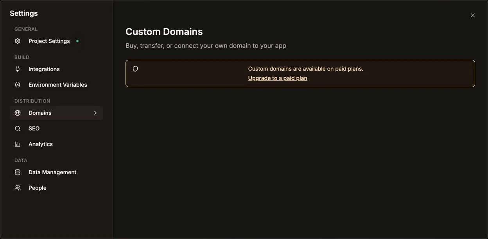

Build apps together with team members using Kleap's collaboration features.

## Team Features

- **Shared apps** - Multiple people can work on the same app
- **Role management** - Control who can do what
- **App transfer** - Move apps between accounts
- **Team billing** - Centralized credit management

## Inviting Team Members

### Add to an App

1. Open your app
2. Go to **Settings** > **Project settings** > **People**
3. Click **Invite Member**
4. Enter their email address
5. Select their role
6. Send invitation

<Frame caption="People is available in the Data section of Project settings">
  
</Frame>

### Invitation Flow

1. Team member receives email
2. They click the invite link
3. Sign up or log in to Kleap
4. Access is granted automatically

<Info>
  Team members need their own Kleap account to collaborate.
</Info>

## Roles & Permissions

| Role | View | Edit | Deploy | Settings | Billing |
|------|------|------|--------|----------|---------|
| **Viewer** | ✓ | - | - | - | - |
| **Editor** | ✓ | ✓ | ✓ | - | - |
| **Owner** | ✓ | ✓ | ✓ | ✓ | ✓ |

### Role Details

<AccordionGroup>
  <Accordion title="Viewer">
    Can view the app, code, and preview. Cannot make changes.
  </Accordion>

  <Accordion title="Editor">
    Can edit the app using AI chat and code editor, and deploy to production. Cannot change app settings.
  </Accordion>

  <Accordion title="Owner">
    Complete control including billing, settings, deletion, and transfer.
  </Accordion>
</AccordionGroup>

## Managing Team Members

### Change Role

1. Go to **Settings** > **Project settings** > **People**
2. Find the team member
3. Click their role dropdown
4. Select new role

### Remove Member

1. Go to **Settings** > **Project settings** > **People**
2. Find the team member
3. Click **Remove**
4. Confirm removal

<Warning>
  Removed members lose access immediately but their previous edits remain.
</Warning>

## App Transfer

Transfer a project to another account, for example to hand a finished site to your client. Only the project owner can do it.

1. Open the project, click the project name (top-left) > **Project settings**
2. In the **Transfer Ownership** block, enter the recipient's email and click **Send Invitation**
3. The recipient gets an email with a link. They must sign in (or sign up) with that exact email address and click accept
4. The link is valid for 7 days. Until it is accepted you can cancel it from the same block. Only one pending transfer per project is allowed

<Info>
  After the transfer you stay on the project as an **admin** member, so it stays in your project list. The new owner can remove you from the project's user list at any time. Connected-app access you had enabled for that project's agents does not carry over to the new owner.
</Info>

## Working Together

### Best Practices

<CardGroup cols={2}>
  <Card title="Communicate changes" icon="comments">
    Let team members know when you're making big changes.
  </Card>
  <Card title="Use version history" icon="clock-rotate-left">
    Check history to see what others have changed.
  </Card>
  <Card title="Assign clear roles" icon="user-tag">
    Give appropriate permissions for each person's job.
  </Card>
  <Card title="Review before deploy" icon="eye">
    Have someone review changes before publishing.
  </Card>
</CardGroup>

### Avoiding Conflicts

Currently, Kleap doesn't have real-time collaboration (like Google Docs). To avoid conflicts:

1. **Communicate** when you're working on the app
2. **Work on different parts** at the same time
3. **Refresh** before starting to get latest changes
4. **Use version history** to recover if needed

## Team Billing

### Credit Usage

- Each edit uses credits from the **app owner's** account
- Team members don't need their own credits to edit
- Owner can view credit usage per team member

### Pro Team Features

On Pro and Enterprise plans:

- More team members allowed
- Priority support for all members

## Limits

| Plan | Team Members per App |
|------|---------------------|
| Free | 2 |
| Pro | 10 |
| Enterprise | Unlimited |

## Enterprise Features

For larger teams, contact us about:

- **SSO** - Single sign-on integration
- **Audit logs** - Track all team activity
- **Custom roles** - Define your own permissions
- **Organization** - Manage multiple teams

<Card title="Need more team features?" icon="building">
  [Contact us](mailto:hello@kleap.co) about Enterprise plans.
</Card>
